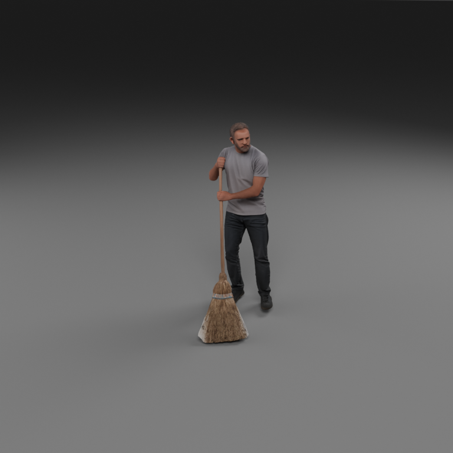

# Asset-Forge

Generate reusable 3D assets from a prompt or an existing image through selectable
image, segmentation and reconstruction backends. A standalone research tool:
no scene generator or dataset project is required.

| Generated source image · FLUX.2-dev | Reconstructed asset · SAM3 + TRELLIS.2, rendered in Blender |
| --- | --- |
| [](docs/images/man-sweeping/flux2-source.png) | [](docs/images/man-sweeping/flux2-trellis2-side.png) |

One image → participant masks → a reusable 3D asset. This selected example uses
optional backends; the default reconstruction backend remains SAM3D.
[See all four backend combinations, more views, masks and settings](docs/backend-observations.md).
Generated example media has [separate scope and attribution](docs/images/man-sweeping/README.md).


Asset-Forge contributes orchestration, model adapters, installation recipes,
exports and comparison previews. The underlying models were developed by
**Black Forest Labs (FLUX), Meta (SAM/SAM3, SAM 3D Objects, DINO) and Microsoft /
the TRELLIS.2 authors (TRELLIS.2)**. Model ownership remains with their authors.
The repository's **MIT licence covers Asset-Forge's own code only**; each model
and dependency keeps its own licence and access conditions. See
[licensing and attribution](THIRD_PARTY.md) and the [scope notice](NOTICE.md).

Model execution has been validated on NVIDIA A100 80 GB GPUs under Linux on
Jean Zay. Other GPUs have not been tested. The generalized installer still
needs a fresh end-to-end GPU validation.

| Stage | Default | Optional |
| --- | --- | --- |
| Image | FLUX.1-dev (`flux`) | FLUX.2 (`flux2`) |
| Mask | SAM3 (`sam3`) | Classic SAM (`sam`) or a supplied mask |
| Reconstruction | SAM 3D Objects (`sam3d`) | TRELLIS.2 (`trellis2`) |
| Exports | Gaussian PLY + mesh GLB for SAM3D | Textured PBR GLB for TRELLIS.2 |

## Install

See the [installation and model-access guide](docs/installation.md).

Before downloading weights, accept/request access on each applicable model
page using the **same Hugging Face account as your read token**:

| Setup | Model approvals |
| --- | --- |
| Default pipeline | [FLUX.1-dev](https://huggingface.co/black-forest-labs/FLUX.1-dev), [SAM3](https://huggingface.co/facebook/sam3), [SAM 3D Objects](https://huggingface.co/facebook/sam-3d-objects) |
| Optional FLUX.2-dev | [FLUX.2-dev](https://huggingface.co/black-forest-labs/FLUX.2-dev) |
| Optional TRELLIS.2 | [DINOv3 encoder](https://huggingface.co/facebook/dinov3-vitl16-pretrain-lvd1689m), in addition to the [TRELLIS.2 checkpoint terms](https://huggingface.co/microsoft/TRELLIS.2-4B) |

Creating a token or logging in does not grant model access. Downloads cannot
proceed until the account has the required approval and the token permits read
access to those repositories. Fine-grained tokens must include the relevant
gated-repository permissions. The installer cannot accept agreements or obtain
approval for you. Enter tokens only at the interactive login prompt.

Choose any writable installation directory on Linux:

```bash
git clone https://github.com/mhurte/Asset-Forge.git
cd Asset-Forge
export AF_INSTALL="/path/on/your/storage/assetforge"
python3 assetgen.py --setup --install-dir "$AF_INSTALL" --environments-only
"$AF_INSTALL/venv_for_assetforge/bin/hf" auth login
```

Then obtain model access, download checkpoints and finish setup as described
in the guide. `--with-extras` installs FLUX.2 and TRELLIS.2, with separate access
requirements including TRELLIS.2's DINOv3 encoder. Weights are not included.
Setup defaults to A100 compilation and can run without a detected GPU.

For a fresh installation test with access preflight and separate GPU validation, see the [test guide](docs/fresh-install-test.md).

Blender is optional: normal setup installs only the generation runtimes. Add
`--with-blender` to setup to download it, or `--blender /path/to/blender` to use
an existing installation. `--render` and comparison previews require Blender.
Use `--test --no-render` for mesh comparisons without previews. The fresh-install
test installs Blender automatically to validate the complete kit.

## Generate

Run inside a suitable GPU allocation, from the checkout:

```bash
python3 assetgen.py --prompt "a blue ceramic teapot" --mask-prompts teapot
python3 assetgen.py --image object.png --mask-prompts object --render
python3 assetgen.py --prompt "a robot riding a bicycle" \
  --mask-prompts robot bicycle --label ROBOT_RIDING_BIKE --render
```

Select optional backends or supply a reviewed mask:

```bash
python3 assetgen.py --prompt "a robot holding a cup" --mask-prompts robot cup \
  --image-backend flux2 --mesh-backend trellis2 --render
python3 assetgen.py --prompt "a blue ceramic teapot" --mask-backend sam
python3 assetgen.py --image object.png --mask foreground.png --render
```

Default generation uses one A100. The tested FLUX.2-dev route uses two A100
80 GB GPUs with balanced BF16 placement and adequate host RAM. These are tested
configurations, not measured minimum hardware requirements.

SAM3 unions a mask for each participant query. Classic SAM unions accepted
automatic proposals; it can retain unwanted regions or miss small objects.
Interactions are reconstructed jointly as one asset, without rigging. Backend
selection is explicit, with no silent model substitution.

## Observed backend differences

In our initial human-action comparison, **TRELLIS.2 preserved facial appearance,
clothing detail and colours better than SAM3D**, using the same image/mask pair
for each reconstruction comparison. This makes it a useful option to try for
human assets. Hands, broom bristles and other thin structures still had artifacts.
This is a qualitative observation from a small test, not a measured general
advantage or a change to the SAM3D default. See the
[comparison notes](docs/backend-observations.md).

## Compare

`--test [PROMPT]` crosses both image generators with both reconstruction
backends, sharing each image/mask pair. The default subject is a yellow mug:

```bash
python3 assetgen.py --test
python3 assetgen.py --test "a man sweeping with a broom" \
  --mask-prompts man broom --label MAN_SWEEPING
python3 assetgen.py --test --mask-backend sam
```

Install optional backends first. To compare SAM3 with classic SAM, run separate
tests with the same prompt and seed. Each run saves a local `index.html` gallery,
JSON/Markdown reports, images, masks, logs, hashes and exported assets. Add
`--output /new/folder` to choose a destination. Failed cells are reported while
other cells continue; exit 2 means a degraded run. No placeholders are passed
off as generated assets.

Studio previews use three oblique views, AgX, 768 pixels, 96 samples and
denoising. `MAN_HOLDING_CUP` adds closer upper-body views. Backend-dependent
orientations can differ. Review masks, action clarity and geometry: hands,
faces and thin structures can be poor despite a passed run.

## Integration and development

Call the CLI or [low-level Python adapters](Pipeline/Asset_gen/README.md).
Deployment paths are stored in ignored `*.local.json` files.

CPU regression tests (no model GPU inference):

```bash
python -m pip install -r requirements-test.txt
python -B -m unittest discover -s tests -v
python -B -m unittest discover -s Pipeline/Asset_gen -p 'test_*.py' -v
```

Our orchestration code uses the [MIT licence](LICENSE). FLUX-dev model licences
have non-commercial model-use terms; SAM3/SAM3D and DINOv3 have custom Meta
licences. TRELLIS.2's MIT licence does not replace its dependencies' terms.
Model-use and generated-output permissions must be checked separately. See
[third-party components and original authors](THIRD_PARTY.md).

GitHub's “MIT license” badge identifies this repository's code licence. It does
not describe every downloaded model or claim that Asset-Forge developed them.

## Mask failure retries

Each enabled masking backend gets up to **three total attempts** by default,
including the initial attempt. Success stops retries immediately. Missing,
corrupt, empty or incorrectly sized output masks count as failures, and stale
outputs are removed before retrying. After exhaustion, normal failure handling
continues; no mask is fabricated. SAM3 retries the failed participant query
without regenerating already successful participants or the source image.

This applies to the low-level `generate_mask` API as well as the standalone CLI.
Set `max_attempts` in the mask JSON config, or pass `max_attempts=1` to the Python
API to disable retries. Standalone masking has a 540-second stage ceiling within
the overall run budget. External caller/job time limits can still end it sooner.
Repeated inference on identical input can fail identically; retries are not a
guarantee of better segmentation or a substitute for reviewing mask quality.
