# Initial backend observations

Qualitative review of an A100 comparison completed on 2026-10-29, using a
full-body man sweeping with a broom on a white background. Both FLUX.1-dev and
FLUX.2-dev source images were reconstructed with SAM3D and TRELLIS.2, sharing
the SAM3 participant-mask union within each image pair. GLB assets were rendered
with the same Blender studio setup; output orientations can still differ.


## Sources and reconstructed assets

Click an image to inspect its full resolution. Each row uses the same source
image and SAM3 mask for both reconstruction backends. The examples are generated
outputs; the main-page showcase is selected from this complete comparison.

### FLUX.1-dev

| Source image | SAM3D GLB render | TRELLIS.2 GLB render |
| --- | --- | --- |
| [](images/man-sweeping/flux-source.png) | [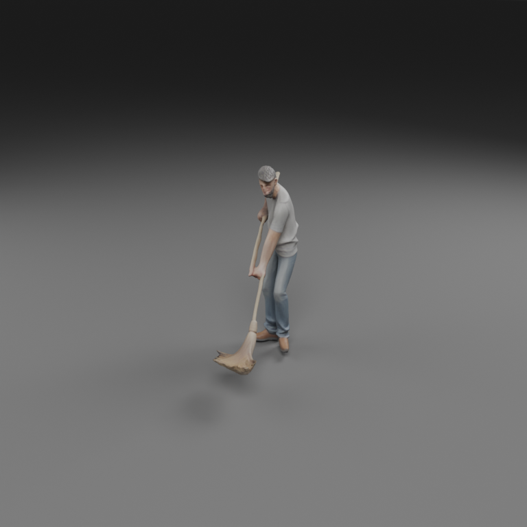](images/man-sweeping/flux-sam3d-side.png) | [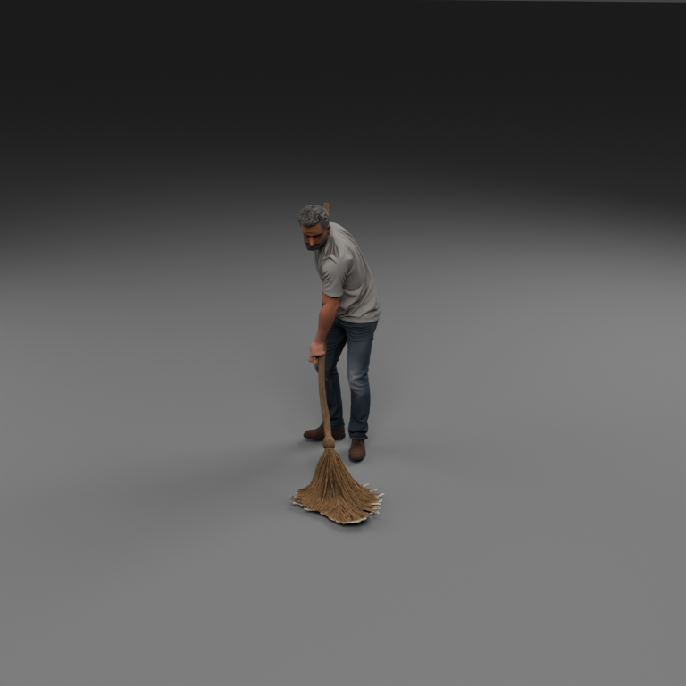](images/man-sweeping/flux-trellis2-side.png) |

### FLUX.2-dev

| Source image | SAM3D GLB render | TRELLIS.2 GLB render |
| --- | --- | --- |
| [](images/man-sweeping/flux2-source.png) | [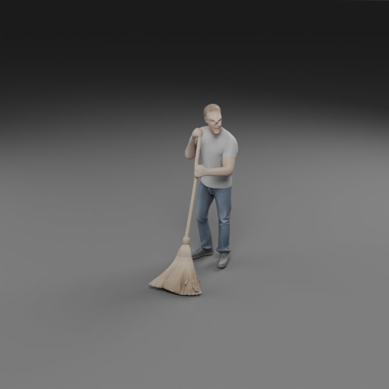](images/man-sweeping/flux2-sam3d-side.png) | [](images/man-sweeping/flux2-trellis2-side.png) |

## Additional views

The same camera-direction presets are used, but reconstruction backends may
produce different object orientations. These views are not calibrated to match
the input photograph's viewpoint.

| Image / reconstruction | High oblique | Reverse oblique |
| --- | --- | --- |
| flux-sam3d | [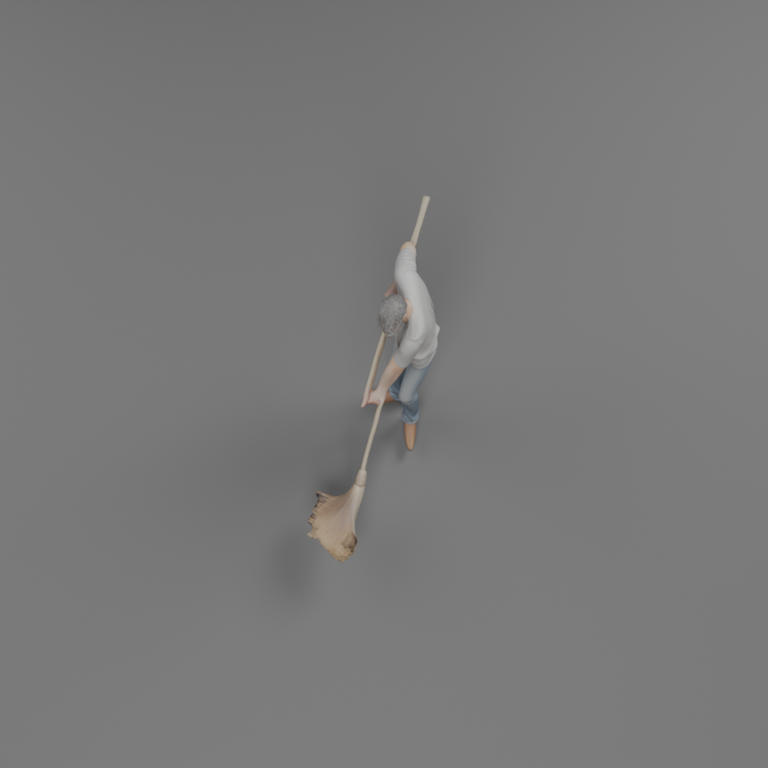](images/man-sweeping/flux-sam3d-high.png) | [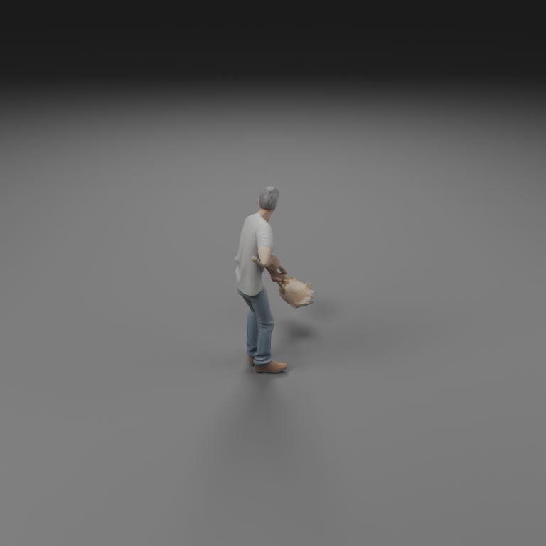](images/man-sweeping/flux-sam3d-reverse.png) |
| flux-trellis2 | [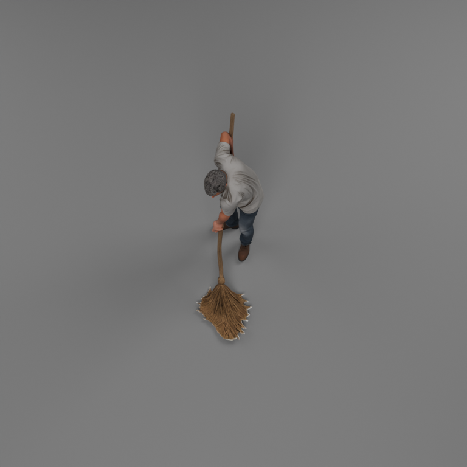](images/man-sweeping/flux-trellis2-high.png) | [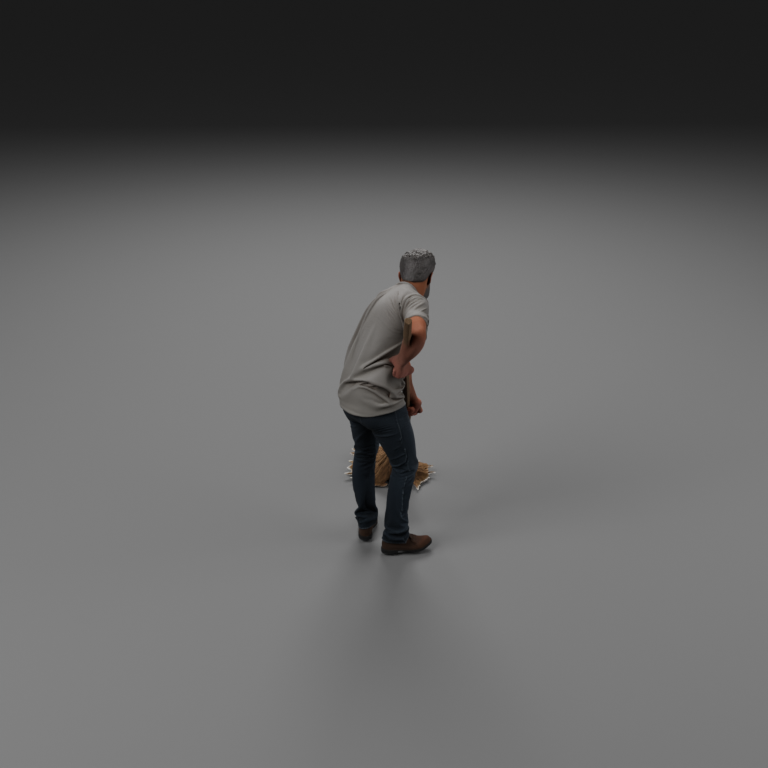](images/man-sweeping/flux-trellis2-reverse.png) |
| flux2-sam3d | [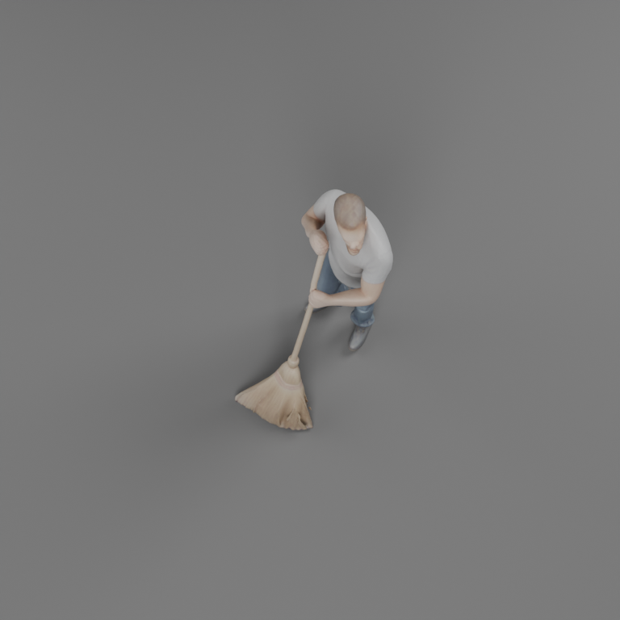](images/man-sweeping/flux2-sam3d-high.png) | [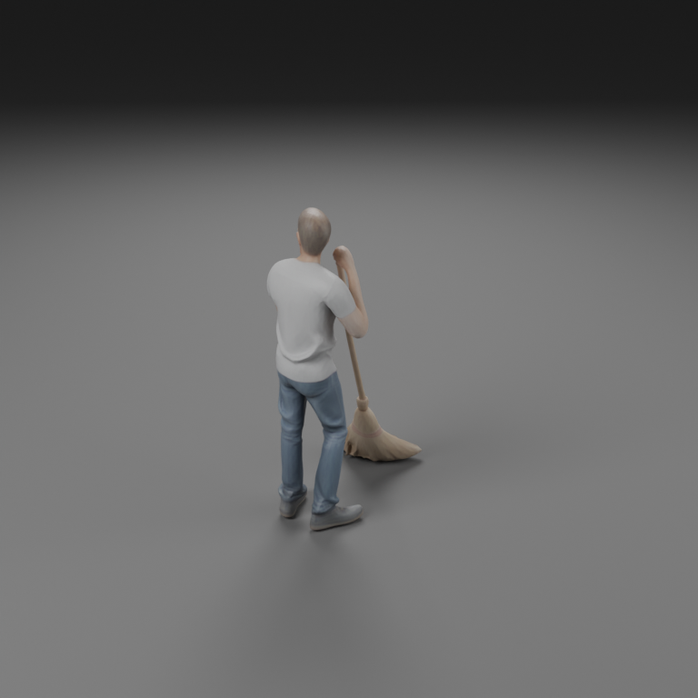](images/man-sweeping/flux2-sam3d-reverse.png) |
| flux2-trellis2 | [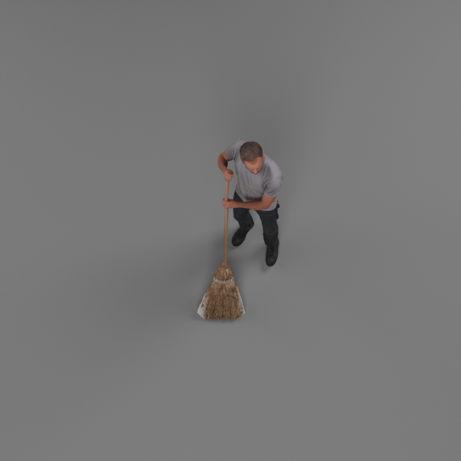](images/man-sweeping/flux2-trellis2-high.png) | [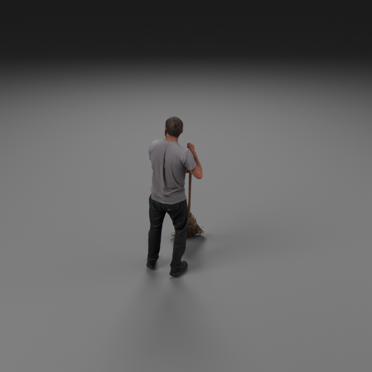](images/man-sweeping/flux2-trellis2-reverse.png) |

## Masks used

| FLUX.1-dev: SAM3 union | FLUX.2-dev: SAM3 union |
| --- | --- |
| [](images/man-sweeping/flux-mask.png) | [](images/man-sweeping/flux2-mask.png) |

The person and broom masks were unioned before joint reconstruction. The broom
head is a filled silhouette: background visible between bristles can be retained
and contribute to a solid skirt/fringe. Reconstruction can also merge thin
strands. The images show the original result, before mask-retry support was added.
Retries on runtime failure do not automatically correct a visually poor mask.

## Prompt and settings

```text
A single adult man sweeping with a long-handled broom, both hands naturally gripping the handle, broom bristles touching the ground beside his feet. Full-body three-quarter view, entire head, feet and complete broom visible, generous blank margins, centered composition. Plain seamless white background, no room, furniture, floor texture or other objects. Sharp face and hands, realistic anatomy and materials, even studio lighting, everything in focus.
```

| Setting | Value |
| --- | --- |
| Seed | 314 |
| SAM3 participant queries | `man`, `broom`; unioned |
| FLUX.1-dev image | 1024 × 1024; 50 steps; guidance 3.5 |
| FLUX.2-dev placement | BF16, transformer on GPU 0, text encoder and VAE on GPU 1 |
| Render | Cycles GPU, studio AgX, 768 × 768, 96 samples, denoising |
| Views | Side, high and reverse oblique; whole-asset framing |
| Display scale | Longest dimension normalized to 1 metre; a display prior, not recovered physical scale |
| Stage status | All four reconstruction and rendering routes passed |

The [sanitized provenance record](images/man-sweeping/provenance.json) includes
file hashes, available optional model/source revisions and per-asset camera
settings. Default model snapshot revisions were not recorded in the original
run. This is an observation record, not a fully locked reproduction package.
Descriptive PNG metadata was removed; displayed pixels are unchanged. See
[media attribution and scope](images/man-sweeping/README.md).

## Interpretation

In this example, TRELLIS.2 preserved facial appearance, clothing texture and
colour more convincingly than SAM3D. SAM3D looked smoother and paler and lost
more facial detail. TRELLIS.2 is therefore worth trying for human/action assets;
the default remains SAM3D. This is a small qualitative comparison, with no
quantitative face-quality metric or evidence of a universal ranking.

Hands remained distorted. Broom bristles were merged into solid geometry, with
edge/background artifacts that may partly originate in the segmentation mask.
These limitations require asset review irrespective of backend.

FLUX.1's source conveyed active sweeping more clearly in this sample, whereas
FLUX.2's source resembled holding a broom. Source-image action fidelity and 3D
reconstruction quality should be evaluated separately. Better-looking faces
do not necessarily imply better action correctness.
